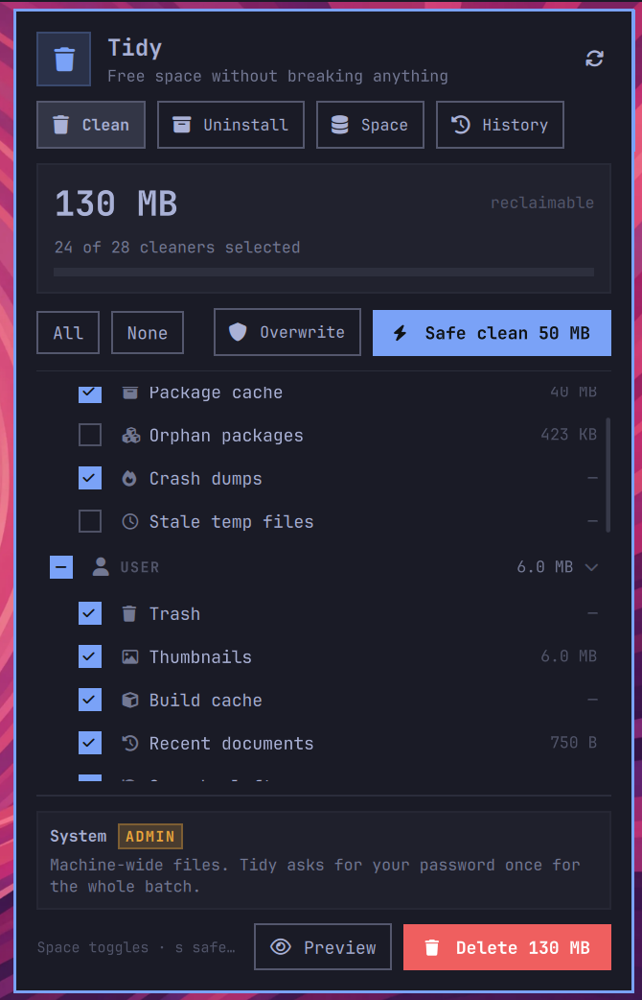

<div align="center">

# 🧹 Tidy

**A BleachBit-style system cleaner for [Omarchy](https://omarchy.org).**

Reclaim space from logs, caches, packages and leftovers — honestly measured,
carefully guarded, one click away.

[](https://github.com/hembramnishant50-glitch/omarchy-tidy)
[](LICENSE)
[](https://omarchy.org)
[](#-architecture)
[](https://github.com/hembramnishant50-glitch/omarchy-tidy/stargazers)

<br>

### ⚡ Install

```bash
omarchy plugin add https://github.com/hembramnishant50-glitch/omarchy-tidy --enable
```

Then add **Tidy** to your bar in *Omarchy menu → Setup → Bar*
(restart the shell if the widget list still looks stale).

<br>



<sub><b>The Clean tab</b> — 28 grouped cleaners, honest sizes, and a single one-click <i>Safe Clean</i>.</sub>

</div>

---

## ✨ Why Tidy

Most cleaners show you a big scary number, delete half of it, and never tell you
the difference. Tidy measures **what is actually deletable** before it touches
anything — so a 4 GB package cache that a clean never frees reports `0 bytes`,
not `4 GB`.

It lives where you already are: an Omarchy bar widget with a full panel behind it.

| Surface | What you get |
|:--|:--|
| 🧩 **Bar widget** | Reclaimable space at a glance + one-click **Safe Clean** |
| 🧼 **Clean tab** | 28 grouped cleaners — preview or run, with live totals |
| 📦 **Apps tab** | Scan your system and uninstall packages with real disk accounting |
| 💽 **Space tab** | Root-level disk overview, no terminal needed |
| 🕘 **History tab** | Every run logged, with undo where it's possible |

---

## 🧰 The cleaners

### 🖥️ System — one `pkexec` prompt for the whole batch

| Cleaner | Removes | Keeps |
|:--|:--|:--|
| **Journal logs** | System logs older than 7 days | The last week |
| **Package cache** | Old versions of installed packages **+** archives of packages you removed (`paccache -rk1` + `-ruk0`) | One version of every installed package — rollback stays possible |
| **Orphan packages** | Dependencies nothing needs any more | Opt-in, never automatic |
| **Crash dumps** | `systemd-coredump` and `/var/crash` | — |
| **Stale temp files** | `/tmp` entries older than 7 days | Anything recent |

### 👤 User — runs as you, no password

| Cleaner | Removes |
|:--|:--|
| **Trash** | Empties `~/.local/share/Trash` |
| **Thumbnails** | Rebuilt on demand by your file manager |
| **Build cache** | `yay` / `paru` build leftovers |
| **Recent documents** | Recently-opened lists |
| **Omarchy leftovers** | Stale `.bak` config backups |
| **Clipboard history** | Saved clipboard entries and copied images (opt-in) |

### 🧩 Applications — caches & leftovers

| Cleaner | Removes | Guard rails |
|:--|:--|:--|
| **Firefox · Chromium · Brave · Helium** | Web, code and GPU caches | Bookmarks, logins and sessions stay |
| **Zen · LibreWolf** | Gecko-style cache folders (`cache2`, `startupCache`, thumbnails) | Bookmarks, logins and sessions stay |
| **Tor Browser** | Download and update staging only | The updater's `.gpg` signature is kept |
| **mise cache** | Downloaded tool archives + its npm package store | Installed toolchains in `~/.local/share/mise` are never touched |
| **mise toolchains** | Tool versions nothing references any more (`mise prune --tools --yes`) | Required versions and running tools are kept |
| **npm cache** | `~/.npm/_cacache` + the npx cache | Packages re-fetch when next needed |
| **Android Studio** | IDE index caches | **Auto-skipped while the IDE is open** |
| **Docker** | Stopped containers, dangling images, build cache | Named volumes kept unless you ask |
| **Flatpak** | Runtimes and apps nothing depends on | Opt-out dependencies are honoured |
| **AyuGram media cache** | Telegram's media and image caches | Re-downloads on next view; login state untouched; skipped while AyuGram is open |
| **File index caches** | Desktop indexer (`tracker3`) database + media cache | Opt-in — a clean costs a full reindex |
| **Omarchy widget caches** | Wallpaper and theme selector thumbnails | Thumbnails rebuild on next use; keybinding records kept |
| **Headless temp** | Leftover `chromium-headless` `scoped_dir*` profiles | Skipped while a headless browser runs |

---

## 🔒 Safety by design

Tidy is built around one rule: **never surprise the user.**

- **👀 Previews first** — every cleaner has a dry run. `tidy-clean --preview` asks
  for zero passwords and deletes nothing.
- **🛡️ The Safe set** — the one-click button and the overnight timer only ever run
  cleaners that need no root and hold nothing but regenerable data
  (`TIDY_SAFE_CLEANERS`).
- **🔑 One password, whole batch** — system cleaners are collected into a single
  `pkexec bash -c`, so polkit prompts exactly once no matter how many you picked.
- **📏 Honest accounting** — sizes are measured before *and* after. What a run
  reports as freed is what actually went away.
- **↩️ Undo where possible** — the history log carries an undo list so recent
  deletions can be restored.
- **🔨 Shred option** — `--shred` overwrites files before unlinking, for the paranoid.

---

## 📋 Requirements

| | |
|:--|:--|
| **Required** | `bash`, `python3`, `pacman`, `polkit` / `pkexec` — all standard on Omarchy |
| **Optional** | `expac`, `docker`, `flatpak`, `mise`, `npm` — extra cleaners light up when these exist |

Missing an optional dependency is never an error: the cleaner simply reports
*why* it can't run instead of guessing.

---

## ⌨️ CLI

The panel is a thin skin over plain bash scripts — everything is scriptable.

```bash
# What could be reclaimed, as JSON
tidy-scan

# Dry run — no root needed, changes nothing
tidy-clean --preview --safe

# Run only the passwordless safe set
tidy-clean --safe

# Run specific cleaners (system ones ask for one password)
tidy-clean pkgcache journal

# App discovery + uninstall with disk accounting
tidy-uninstall list
tidy-uninstall preview pacman:code

# History, restore points, scheduled auto-clean status
tidy-state history
tidy-state undo-list
tidy-schedule status
tidy-schedule enable daily
```

---

## 🏛️ Architecture

```
┌─────────────────── Omarchy shell ────────────────────┐
│  BarWidget.qml ─── Panel.qml ─── Model.js (manifest)  │
│    └── four views: Clean · Apps · Space · History     │
└──────────────┬───────────────────────────────────────┘
               │ QProcess
┌──────────────▼───────────────────────────────────────┐
│  scripts/                                             │
│    tidy-scan       read-only measurement → JSON       │
│    tidy-clean      dry-run pass → RESULT lines        │
│    tidy-uninstall  package scanner / uninstaller      │
│    tidy-state      history + undo store (Python)      │
│    tidy-schedule   auto-clean timer                   │
│    tidy-lib.sh     every cleaner definition, one per id│
└───────────────────────────────────────────────────────┘
```

Every cleaner is four small bash functions: `measure_`, `files_`, `avail_`
(with a human-readable reason when it can't run) and `clean_`. Adding a cleaner
is adding one stanza — the panel, the scheduler and the history find it
automatically.

---

## ❓ FAQ

<details>
<summary><b>Is the Safe Clean really safe to run unattended?</b></summary>

Yes. It never elevates, only touches regenerable caches, and the scheduler uses
exactly that set by default.

</details>

<details>
<summary><b>Why did my package cache show 4 GB that a clean never freed?</b></summary>

Because raw directory size isn't the reclaimable size — pacman deliberately keeps
one copy of every installed package. Tidy measures the *deletable* share via
`paccache` dry runs, so the number you see is the number you get.

</details>

<details>
<summary><b>Can I add my own cleaner?</b></summary>

Copy a stanza in `scripts/tidy-lib.sh`, add the four functions, register the id in
`TIDY_CLEANERS` (and in `Model.js` for the UI row). That's it.

</details>

<details>
<summary><b>Will it delete my browser logins or Telegram session?</b></summary>

No. Browser cleaners touch cache folders only, and the AyuGram cleaner never
touches login state. Anything that would cost you a re-login is out of scope by
design.

</details>

---

<div align="center">

**[MIT](LICENSE)** — free to use, hack, and fork.

If Tidy saved you a few gigabytes, a ⭐ helps other Omarchy users find it.

</div>
